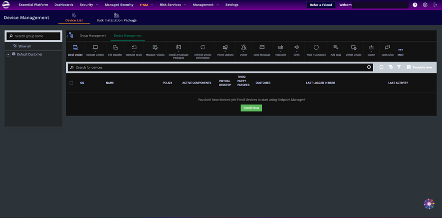
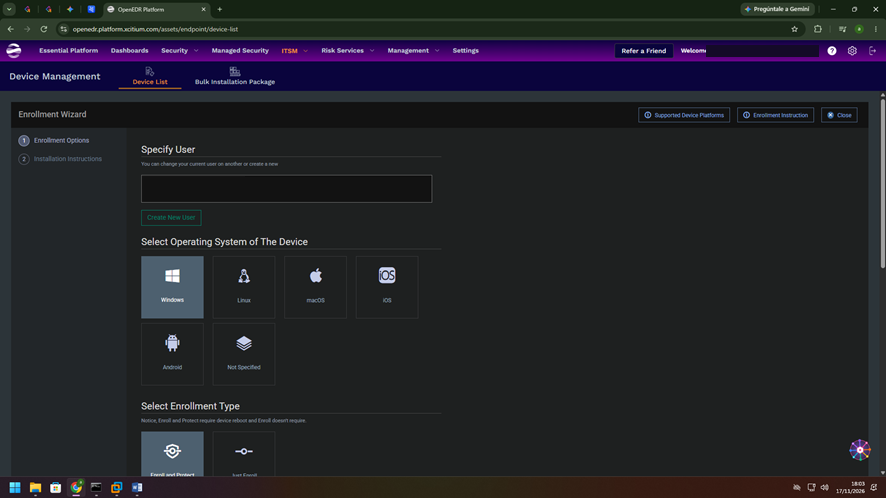
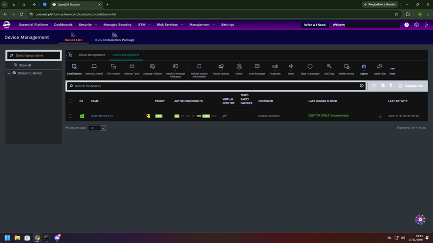
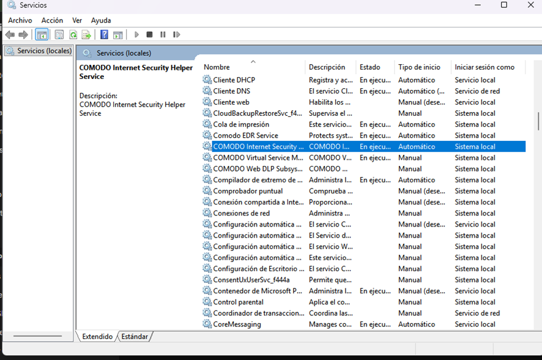
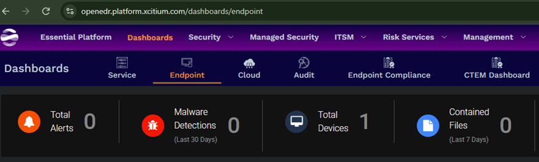

# OpenEDR Deployment and Verification Lab

## Overview
This laboratory documents the deployment, configuration, and verification of an OpenEDR endpoint detection and response agent on a Windows 10 host (`DESKTOP-2FI5L91`). The objective is to validate cloud-to-endpoint communication, service persistence, and telemetry reporting to the central Xcitium platform.

---

## Technical Environment & Components
- **EDR Platform:** Xcitium / OpenEDR (Endpoint Manager / ITSM).
- **Host Operating System:** Windows 10 x64 (`DESKTOP-2FI5L91`).
- **Critical Components Installed:** Communication Client, Xcitium Client - Security, and EXDR.
- **Active Security Modules:** AG (Antimalware Guard), AV (Antivirus), FW (Firewall), EDR, and EXDR.

---

## Deployment & Verification Phases

### 1. Device Enrollment & Registration
- **Description:** Configuration of the provisioning wizard within the Xcitium ITSM platform and validation of host registration under the device inventory.
- **Evidence:**

**Initial Console State (Empty Inventory):**

**Enrollment Wizard Configuration (Windows platform selection and enrollment parameters):**

**Active Enrolled Device (Confirmation that host `DESKTOP-2FI5L91` is online with active security modules):**

---

### 2. Operating System Services Verification
- **Description:** Internal host validation via Windows Services manager (`services.msc`) to verify the execution state and persistence of security daemons.
- **Evidence:**

**Windows Services Console (*Comodo EDR Service* and *COMODO Internet Security* running under Automatic startup type):**

---

### 3. Telemetry & Dashboard Monitoring
- **Description:** Inspection of global endpoint metrics on the centralized dashboard to confirm host status reporting.
- **Evidence:**

**Dashboards > Endpoint View (Reflecting Total Devices: 1, formally validating host telemetry integration):**

---

## Conclusions
- Successfully completed the manual deployment of the agent via standalone installer with elevated privileges, bypassing mass-deployment constraints.
- Verified system integrity at both the cloud console and local Windows services levels, ensuring the agent is fully operational for SOC Tier 1 behavior analysis and incident response.
