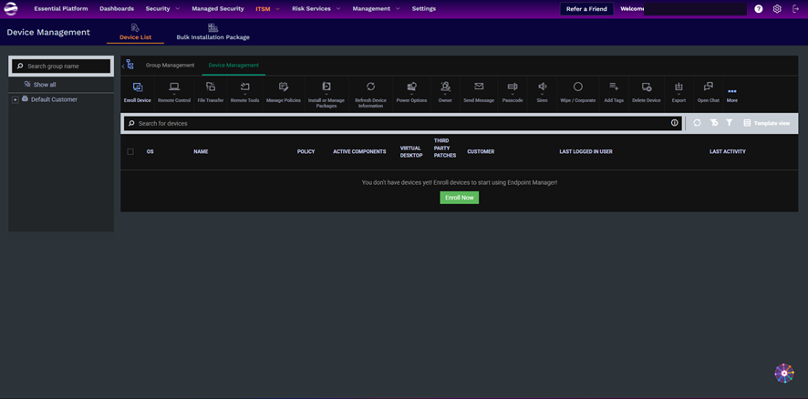
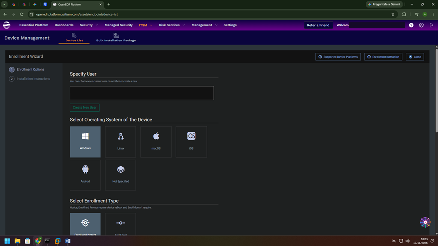
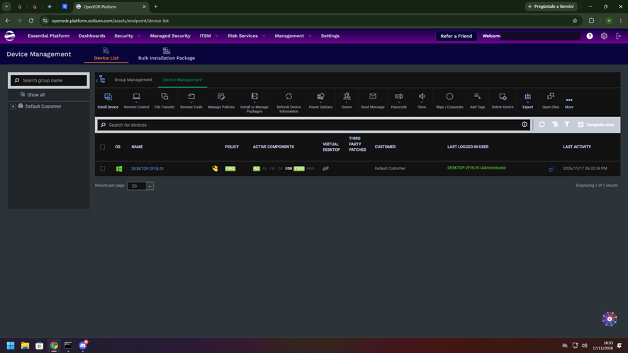
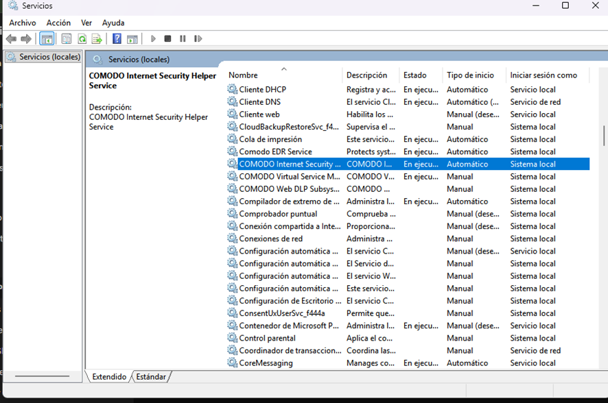
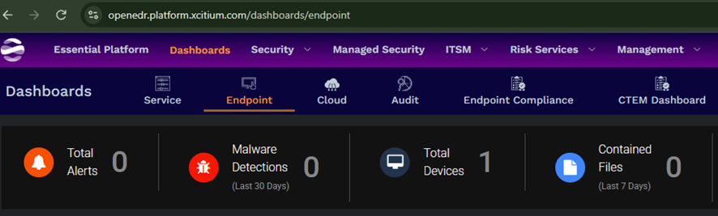

# 🛡️ OpenEDR (Xcitium) Agent Deployment and Verification on Windows

## 📋 Project Overview
This lab documents the technical process of enrolling, locally deploying, and operationally verifying an **EDR / EXDR (Endpoint Detection and Response)** agent using the **OpenEDR / Xcitium** platform on a **Windows x64** host[cite: 12]. The objective is to establish centralized, real-time visibility and telemetry for endpoint-level threat detection and response[cite: 12].

---

## 🛠️ Environment and Tools Used
* **EDR Platform:** Xcitium / OpenEDR Cloud Console (ITSM / Endpoint Manager)[cite: 12]
* **Target Operating System:** Windows 10/11 (x64)[cite: 12]
* **Deployed Modules:**[cite: 12]
  * `AG` (Agent / Communication Client)[cite: 12]
  * `AV` (Antivirus)[cite: 12]
  * `FW` (Firewall)[cite: 12]
  * `EDR` / `EXDR` (Endpoint Detection & Response)[cite: 12]
* **Verification Tools:** Command Prompt (CMD with Administrator privileges) and Windows Services Manager (`services.msc`)[cite: 12].

---

## 🚀 Implementation Process and Evidence

### 1. Initial State of the Management Console
Before starting the deployment, the inventory is checked under **ITSM > Device Management > Device List**, confirming that no endpoints are currently enrolled under the assigned tenant[cite: 12].

---

### 2. Enrollment Package Generation
Through the **Enrollment Wizard**, the target platform (**Windows**) and the **Enroll and Protect** mode are selected to generate the specific installer linked to the corresponding user and security policies[cite: 12].

---

### 3. Troubleshooting and Local Deployment
During the installation phase, the operational difference between the network mass-discovery utility (*Auto Discovery and Deployment Tool*) and the standalone agent installer (`installer_...`) was identified[cite: 12]. 

To ensure a clean installation without UI hangs, the standalone package was executed directly from an **elevated Command Prompt (Administrator)**, completing the registration and rebooting the operating system to apply the network and security drivers[cite: 12].

---

### 4. Console Registration and Active Modules Verification
After rebooting the host, the web console confirms that the machine (`DESKTOP-2FI5L91`) is connected online with all critical defense components active (`AG`, `AV`, `FW`, `EDR`, `EXDR`)[cite: 12].

---

### 5. Local Windows Services Audit
To validate persistence and proper execution at the operating system level, `services.msc` was inspected, confirming that **Comodo EDR Service** and **COMODO Internet Security** are in a **Running** state and configured with an **Automatic** startup type[cite: 12].

---

### 6. Dashboard Telemetry Validation
Finally, in the **Dashboards > Endpoint** view, active telemetry reception is verified with the **Total Devices: 1** counter, leaving the environment ready for continuous monitoring and event analysis[cite: 12].

---

## 💡 Conclusions and Demonstrated Skills
* **Endpoint Management (EDR):** Configuration of security agents from a cloud console down to the target host[cite: 12].
* **Technical Troubleshooting:** Diagnosis and resolution of installation issues via elevated command-line execution[cite: 12].
* **In-Depth Validation:** Cross-verification both in the cloud (telemetry) and locally within the operating system (`services.msc`)[cite: 12].
* **Security Best Practices:** Sanitization and redaction of sensitive information (PII) in public technical evidence[cite: 12].